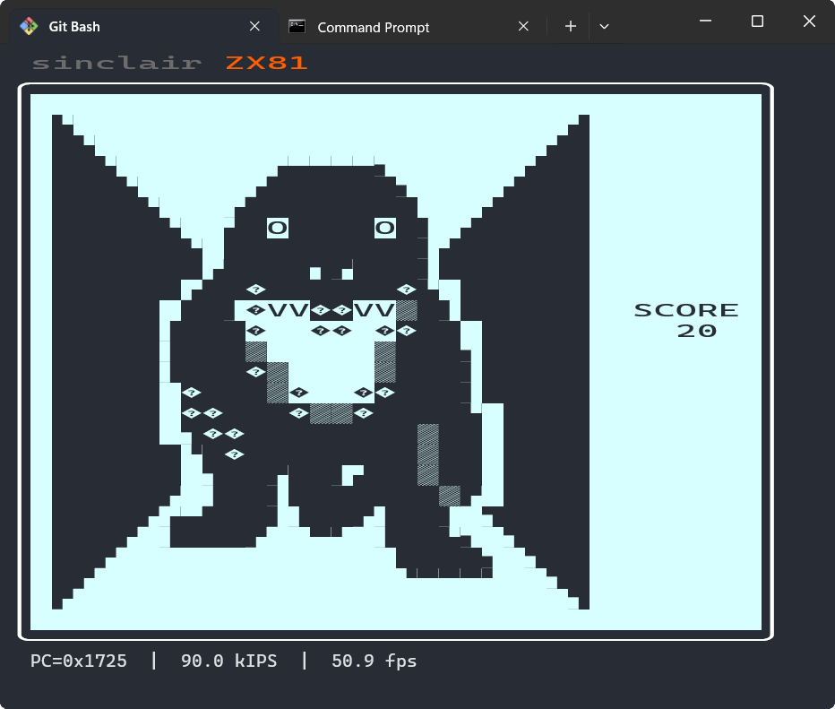

# `play-eightbit`

An emulator for the Zilog Z80 8-bit CPU, to allow machine emulation of the Sinclair ZX81.

### Limitations of the Z80 CPU emulation

- Non-maskable interrupts, and maskable interrupts in mode 1, are supported (that's all the ZX81
  needs). Interrupt modes 0 and 2 aren't, and an interrupt can be accepted straight after `EI`.
- I/O instructions (`IN`, `IND`, `INDR`, `INI`, `INIR` and `OUT`, `OUTD`, `OTDR`, `OUTI`, `OTIR`)
  are not correctly implemented yet (particularly how they affect the condition bits / flags).
- The CPU doesn't count T-states or machine cycles, so the ZX81 emulation times instructions on
  average (see below).
- Although, ironically, most undocumented instructions had to be implemented to get the `zexdoc`
  tests to pass, the condition bits 3 and 5 (also known as flags X and Y) are not currently
  implemented.
- The `zexdoc` tests don't test interrupt or I/O instructions, so there could be unexpected issues
  in these areas. `InterruptTest` covers the basics of interrupts.

### Limitations of the ZX81 machine emulation

- The ZX81 ROM file should be placed at `src/main/resources/z80/zx81/zx81.rom`, and any program
  files you would like to be able to load should be located in `src/main/resources/z80/zx81/` with
  a lowercase filename and the file extension `.p`. To avoid issues with redistribution rights,
  these are not published to the GitHub repository. If I can get confirmation that these files are
  redistributable, this may change.
- The emulator provides for `LOAD` of the `.p` files by typing `LOAD "MYSAVEDFILE"` in the emulator
  to load the resource `/z80/zx81/mysavedfile.p` from the classpath as a saved program. If there is
  no such file, `LOAD` stops with report D (BREAK), as a real ZX81 does when you give up waiting for
  a tape. There is no corresponding `SAVE` command.
- The program files are read from the jar file when you type `LOAD`, so rebuilding the jar while
  the emulator runs makes `LOAD` fail. Restart the emulator after a rebuild.
- `SLOW` and `FAST` modes work as on a real ZX81. The emulator has the NMI generator, which
  interrupts once a scan line while it is on, and the interrupt from bit 6 of the R register, so
  the ROM's own display routines run. In `SLOW` mode, they run the display file, update `FRAMES`,
  and scan the keyboard into `LAST_K` 50 times a second, whatever the program is doing. In `FAST`
  mode, the ROM only produces a picture while it waits for a key or in `PAUSE`; a real TV shows no
  picture while a program runs. The emulator shows the screen in two close shades of grey then, so
  it looks dimmed.
- The terminal shows the display file that the CPU runs in each frame, so games that run their own
  display file (instead of the one `D_FILE` points to) show correctly.
- Instructions are timed on average (6.9 T-states each), except for the NOPs run in the display
  file and by `HALT` (4 T-states each). So `FAST` mode runs about four times faster than `SLOW`
  mode, as on a real ZX81, and timings are close to a real ZX81's but not exact.
- The display is terminal-based, so it cannot support high-resolution graphics (even if the display
  were pixel-based, ZX81 pseudo-HRG requires CPU cycle-level timing to work, which the CPU
  emulation does not currently support).
- The Unicode ["Symbols for Legacy Computing" block](https://www.unicode.org/charts/PDF/U1FB00.pdf)
  is not well-supported by fonts, so the half-grey graphic symbols (U+1FB8E and U+1FB8F and their
  inverted counterparts) may appear as the unknown glyph symbol (e.g. question mark in a diamond).
- The emulator runs in a terminal on Windows, macOS and Linux. On Windows, you'll need a version
  (likely a recent build of Windows 10 or Windows 11) that supports UTF-8 console, and virtual
  terminal processing (including ANSI escapes for 256-color terminals).

### Emulator keys

- Ctrl+C closes the emulator.
- Ctrl+1 to Ctrl+8 set the emulation speed to 1 to 8 times real speed. Ctrl+9 runs as fast as
  possible, and Ctrl+0 freezes the emulator until another speed is chosen. The status line shows
  the speed.
- Alt+0 to Alt+9 do the same. Use these where Ctrl+digit keys don't reach the emulator: Windows
  Terminal uses Ctrl+0 to reset the font size, and most macOS and Linux terminals don't send
  Ctrl+digit keys at all.
- Ctrl+K changes the keyboard mode (see below). The second status line shows the mode.

### Keyboard modes

The ZX81 has 40 keys: 0-9, A-Z, NEWLINE, `.`, SPACE and SHIFT. Shifted keys type symbols and some
keywords, so (for example) `*` is Shift+B and `TO` is Shift+4. There are three ways to map a PC
keyboard to it. Choose one with `--keyboard=convenience` (the default), `--keyboard=native` or
`--keyboard=gaming` (for example, `./run.sh --keyboard=gaming`), or change between them with
Ctrl+K.

- **Convenience:** characters type the ZX81 character they look like, so `*` types `*` (Shift+B)
  and `"` types `"` (Shift+P). `^` types `**` (raise to the power). Letters type capitals whatever
  their case, as the ZX81 has only capitals. Characters the ZX81 doesn't have do nothing.
- **Native:** keys act as the key in the same place on the ZX81, with or without Shift. So Shift+8
  is the ZX81's right arrow, and Shift+2 is `AND`. On Windows this works with any keyboard layout.
  macOS and Linux terminals report characters rather than keys, so there this assumes a US layout.
- **Gaming:** as native, but the arrow keys type 5, 6, 7 and 8 without Shift, as many games use
  those keys for left, down, up and right. Only the latest key typed is kept, so holding down a key
  can't build up a backlog of key presses.

In all modes:

- Enter is NEWLINE and Backspace is RUBOUT (Shift+0).
- The arrow keys are the ZX81's arrows (Shift+5 to Shift+8), except in gaming mode.
- Ctrl+E is EDIT (Shift+1), Ctrl+F is FUNCTION (Shift+NEWLINE) and Ctrl+G is GRAPHICS (Shift+9).
- Tab makes the next key shifted, so Tab then 4 types `TO`. This is how to type the shifted
  keywords in convenience mode. The second status line shows `SHIFT` until the next key.
- A terminal doesn't say how long a key is held down, so each typed key is held down for 150 ms.
  That is long enough for games that only look at the keyboard a few times a second. When the ROM
  has taken the key and waits for the next one, the key is released straight away.
- Only one key is held down at a time, and the next key waits until there has been no key for
  100 ms, as the ROM needs to see no key between keys. Keys typed faster than that are queued, so
  typing goes in at about five keys a second, which is about as fast as a real ZX81 takes keys.
- A key is only pressed when the program asks for one: when the ROM waits for a key or runs
  `INKEY$` or `PAUSE`, or a program reads the keyboard or `LAST_K` itself. So keys typed while
  the program is busy wait until it is ready, rather than being lost. SPACE is also pressed when
  the ROM checks for BREAK, so SPACE stops a BASIC program in `FAST` or `SLOW` mode, with
  report D.
- In gaming mode, a key that the terminal repeats while you hold it down stays held down. Most
  terminals wait about half a second before they repeat a key, so a game sees a short press, a
  pause, and then the key held down.

### Running scripts

`ScriptedZX81` (in `src/testFixtures`) runs the emulator without a terminal. It types keys from a
script, in native mode with a US layout, and prints the screen as text. For example, this types
and runs a one-line program as fast as possible. With Shift, `P` types `"`, `L` types `=`, `X`
types `;` and `B` types `*`:

```
./gradlew -q runScript --args="'{9}10pP7 x 7 L PX7B7\nr\n~' 150"
```

See the class documentation for the script commands. The tests in `ZX81MachineTest` use it, and
are skipped if the ROM file isn't present.

### Screenshot

